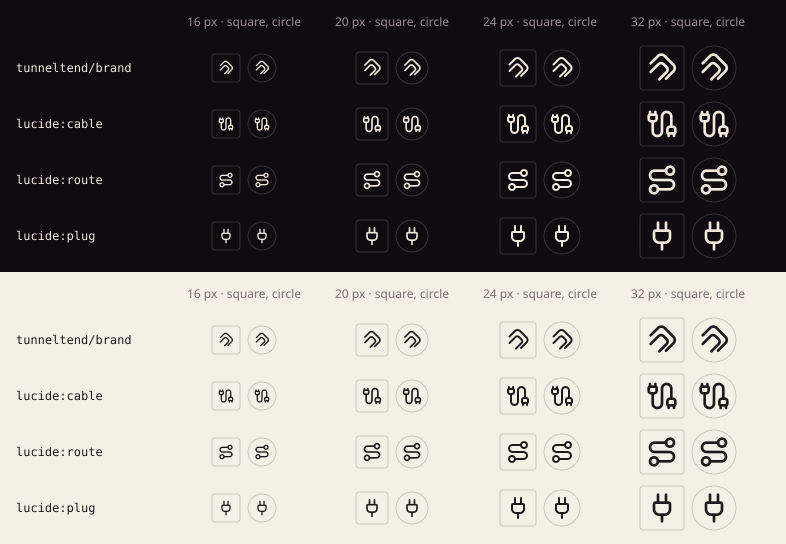

# TunnelTend icon family

## Meaning

This document maps TunnelTend's approved identity to the shared icon system. It owns the meaning and boundary of the `tunneltend/*` glyphs: where the compact Fold replaces the formal lockup, what the package carries of it, and what stays with TunnelTend's own brand bundle. The coloured Fold, wordmark, lockup, favicon and application icon remain TunnelTend's identity assets, owned by [`Wolfsblvt/tunneltend`](https://github.com/Wolfsblvt/tunneltend), not this package.



## Standing

- `tunneltend/brand` is accepted and available.

It comes from owner-approved identity work, not a new design round. Wolf approved The Fold on 2026-10-17 and directed on 2026-10-24 that the glyph be added here so the Works website's contact picker can show it. The [contact sheet](tunneltend-contact-sheet.svg) shows it at 16, 20, 24 and 32 pixels on dark and light surfaces, in square and circle references, beside `lucide:cable`, `lucide:route` and `lucide:plug` for density.

## Accepted glyphs

### `tunneltend/brand`

**Meaning:** compact TunnelTend identity.

**Useful surfaces:** the TunnelTend entry in the Works contact form's project picker, product links and provider-style rows, and other slots where the formal `TunnelTend` lockup does not fit.

**Source:** the tintable master of The Fold, `brand/bundle/tunneltend/assets/mark-primary/on-light-tintable.svg` at `Wolfsblvt/tunneltend@09d53a473de6db9b29ad1aa67e44252dc8a82bc4` (SHA-256 `f0b34ebf99cc899c559e8e4992985caca8e01f3f455d45c1e45759ef8262b77c`). Its path data is carried unchanged: that master is already a 24×24, 2px round-stroke, `currentColor` line mark, so the icon standard needed no translation. Only the XML layout was reformatted.

**What it is:** two independent rounded paths nested in a stable turn. The inner stroke is deliberately asymmetrical. TunnelTend's branding forbids mirroring it, closing either path, adding a third nested line, or reading it as health status; this package follows those rules.

**Why custom:** TunnelTend is a product identity, not an interface concept. A cable, plug or route icon would describe a tunnel without being TunnelTend, and TunnelTend's own identity rules reject VPN, lock, shield and proxy imagery.

## Usage rules

- The glyph inherits `currentColor`. Do not recolour it to imitate the cyan Fold; the coloured mark stays with TunnelTend's brand bundle.
- TunnelTend's favicon variant (a heavier 2.35px stroke with shorter tails, meant below 24 px) is not part of this package, because the icon standard fixes 2px strokes. At 16 px the Fold holds, as the contact sheet shows.
- Beside a visible name the glyph is decorative; as the only content of a link it needs the link's accessible name ("TunnelTend").
- The glyph never stands in for the lockup in a page header, README title or social card.
- Ordinary connection, route or plug meaning keeps `lucide:cable`, `lucide:route` and friends.

## Runtime and consumer consequence

The accepted glyph is authoritative in:

```text
src/icons/products/tunneltend/
src/metadata/products/tunneltend/
src/generated/custom-icons.ts
src/catalog/products.ts
```

Consumers resolve the name through `resolveProductIcon(...)` or `<ProductIcon ... />`. `tunneltend/brand` is compatibility-bearing package API once published.
